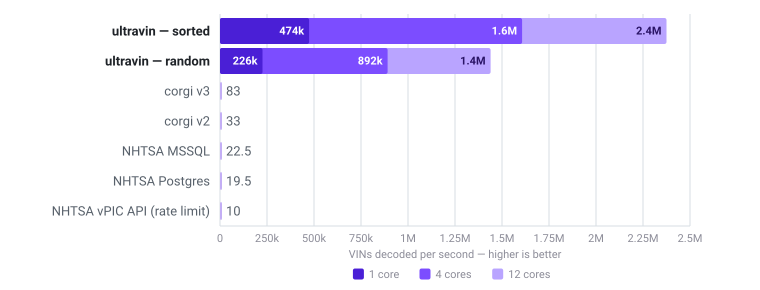
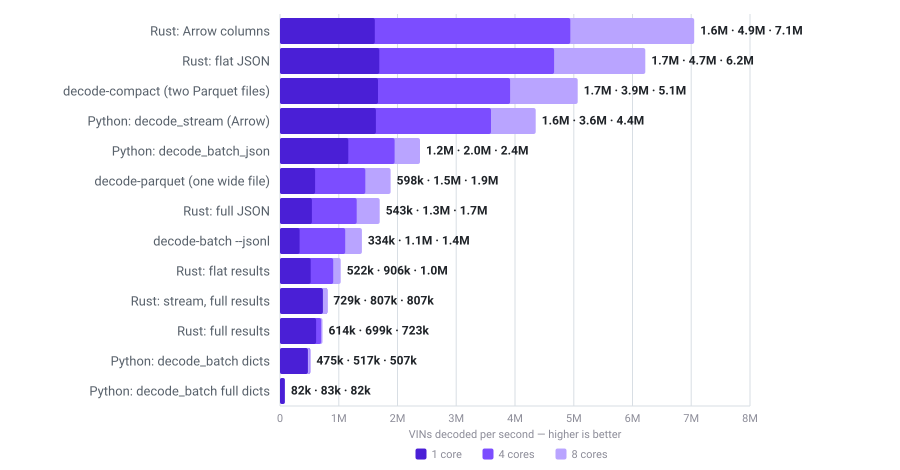

# ultravin

<p align="center">
  <a href="https://github.com/blackthorn-interstellar/ultravin/actions/workflows/ci.yaml"></a>
  <a href="https://pypi.org/project/ultravin/"></a>
  <a href="https://github.com/blackthorn-interstellar/ultravin/blob/master/LICENSE"></a>
</p>

**An extremely fast, fully offline NHTSA vPIC VIN decoder, written in Rust.**

<p align="center">
  
</p>

- ⚡️ ~307,000× faster than NHTSA's own `spVinDecode` — 6.9 million VIN/s on 8 cores, file in to file out, on New York's real registrations
- 🦀 Pure Rust core, shipped as a Python library and a Rust crate
- 📦 The entire vPIC vehicle database baked into the wheel
- 🔌 Fully offline — no network, no database, no data files at runtime
- 🎯 Full-field vPIC parity, tested across decoding rules and their interactions — with documented upstream defects corrected ([accuracy policy](docs/ACCEPTANCE.md), [evidence](docs/KNOWN_DEVIATIONS.md))
- 🐍 Installable via `pip`, with a CLI and a library API
- 🗃️ Parquet in, parquet out — decodes a dataset of any size in the memory of one chunk

ultravin brings the complete `spVinDecode` algorithm into your process: vehicle
attributes, model-year resolution, VIN correction, errors, and provenance.
It checks every output field against NHTSA's unmodified Postgres procedure and
corrects documented defects in the upstream data and procedures. You get vPIC
fidelity with better answers on those defective cases, at **over 300,000× the
NHTSA SQL Server baseline** on 8 cores.
[Benchmarks and reproduction](docs/BENCHMARKS.md).

The complete vehicle database ships inside the binary. No network, no database
server, no runtime data files. Install it and decode.

## Getting Started

### Installation

```bash
uv add ultravin
```

Prebuilt wheels require **Python 3.10+** and nothing else — the data ships inside
the wheel.

### Usage

From Python:

```python
import ultravin

r = ultravin.decode("1HGCM82633A004352")

r["model_year"]  # 2003
r["wmi"]  # '1HG'
r["check_digit_valid"]  # True
r["error_codes"]  # [0]

# `attributes` is the decoded vehicle, one entry per vPIC variable:
r["attributes"]["Make"]  # 'HONDA'
r["attributes"]["Model"]  # 'Accord'
```

`decode(vin)` returns a `dict` with keys `vin`, `wmi`, `descriptor`,
`model_year`, `error_codes`, `check_digit_valid`, `corrected_vin`, and
`attributes` — a single `variable -> value` mapping. Values are `str`, except the
free-text note fields listed in `ultravin.MULTI_VALUED`, which are **always**
`list[str]`: those are the only vPIC elements allowed to repeat within one
decode, and each row is a separate note rather than a competing value.

Decode many at once with `decode_batch`:

```python
results = ultravin.decode_batch(["1HGCM82633A004352", "5YJ3E1EA7JF000000"])
```

If you already know a vehicle's model year, pass it — the same optional hint the
vPIC API calls `modelyear`. It matters for pre-2010 vehicles, where the VIN's
year character is ambiguous (`A` means 1980 *or* 2010): the hinted year gets its
own decode pass that competes against the VIN-derived one, and a hint that
contradicts the decoded year adds error code 12.

```python
ultravin.decode("1HGCM82633A004352", year=1995)  # decodes as a 1995
ultravin.decode_batch(vins, years=[2011, None, 1987])  # one entry per VIN
```

### Provenance: `full=True`

The default keeps the value and drops the provenance. If you need to know *where*
a value came from — `source`, over half of all rows being vehicle-type defaults
rather than something the VIN encodes — or the raw vPIC `attribute_id`, pass
`full=True`:

```python
r = ultravin.decode("1HGCM82633A004352", full=True)

next(e for e in r["elements"] if e["variable"] == "Make")
# {'group_name': 'General', 'variable': 'Make', 'value': 'HONDA', 'source': 'pattern - model', …}
```

`full=True` replaces `attributes` with `elements`, a list of per-attribute dicts
(`group_name`, `variable`, `value`, `element_id`, `attribute_id`, `source`,
`pattern_id`, …), and works the same on `decode_batch`, `decode_json` and
`decode_batch_json`. It is **~2× slower end to end**: decoding is not the
expensive part, and `elements` costs ~615 dict entries per VIN against the
default's ~41.

`ultravin.ELEMENTS` maps each variable name to its static metadata
(`element_id`, `group_name`, `data_type`, …). Pin to `element_id` if you need a
key that survives NHTSA renaming a variable between data releases.

From the command line:

```bash
ultravin decode 1HGCM82633A004352             # JSON object
ultravin decode 1HGCM82633A004352 --year 1995 # with a caller model-year hint
ultravin decode 1HGCM82633A004352 --full      # with per-element provenance
ultravin decode-batch vins.txt                # one VIN per line -> JSON array
ultravin decode-batch - --jsonl < vins.txt    # stdin -> streaming JSON Lines
ultravin decode-batch vins.txt --jsonl --batch-size 1000
ultravin info                                # decoder version + data identity as JSON
ultravin version
```

`decode-batch` accepts `VIN,year` on each input line. JSONL mode processes
bounded chunks and emits complete JSON objects in input order, ready for shell
pipelines. Its automatic default adapts under an 8 MiB working-buffer target;
pass `--batch-size N` to pin a measured size or `--batch-memory-mb N` to change
the automatic target. If a later input line is malformed, the command exits with
an error; already-emitted lines remain valid results.

### Reproducible results

Every batch automatically captures one clock for the whole job. That includes
Python and Rust batches, CLI input loading, every JSONL chunk, and every file in
a Parquet stream. A job that spans a date or year boundary keeps using its
starting instant.

Pin the package version and freeze the decode clock when a job needs to produce
the same answers on a later date:

```python
from datetime import datetime, timezone

as_of = datetime(2026, 9, 1, tzinfo=timezone.utc)
r = ultravin.decode("1HGCM82633A004352", now=as_of)
results = ultravin.decode_batch(vins, now=as_of)
identity = ultravin.provenance()
# data_month, artifact_blake3, decoder_version
```

`now=` also works on the JSON APIs and `decode_stream`. It controls publication
dates and year resolution; `year=` remains the vehicle's model-year hint.
Naive datetimes mean UTC. Each stream captures one clock reading for the whole
job, and its Arrow/Parquet metadata records the data identity and decode clock:
`ultravin.data_month`, `ultravin.artifact_blake3`, `ultravin.decoder_version`,
and `ultravin.now_micros` (Unix epoch microseconds).

## Rust

The engine is its own crate, [`ultravin`](https://crates.io/crates/ultravin):
`cargo add ultravin`, then

```rust
let r = ultravin::decode("1HGCM82633A004352", None);
assert_eq!(r.model_year, Some(2003));
```

The 83 MB vPIC database is too big for crates.io, so the first build fetches it
from the matching GitHub release, verifies it, caches it per machine and bakes it
into your binary — runtime stays fully offline. Offline builds and runtime
loading: [crates/ultravin/README.md](crates/ultravin/README.md).

## Datasets

For bulk work there is `decode_stream` — a stream of decoded Arrow batches,
without a single row ever becoming a Python object:

```python
import ultravin

rows = ultravin.decode_stream("registrations.parquet").to_parquet("decoded.parquet")

rows  # 4812004 — the rows written, not the rows themselves
```

Parquet output replaces its destination only after every batch and the footer
have been written successfully. A failed decode leaves an existing output intact.

The source is a parquet file, a directory of `*.parquet` read in sorted order, or
anything speaking the Arrow C data interface — so the same call takes a pandas
`DataFrame` (pandas ≥ 2.2, with pyarrow installed), a pyarrow `Table`, a polars
`DataFrame`, a duckdb result, or a `RecordBatchReader`. A `DecodeStream` is
itself an Arrow source, which is what lets it hand the decode straight to
whatever you already use:

```python
import pandas as pd, polars as pl, pyarrow as pa, duckdb

df = pd.DataFrame({"vin": ["1HGCM82633A004352", "5YJ3E1EA7KF328931"]})

pl.DataFrame(ultravin.decode_stream(df))  # -> polars
pa.table(ultravin.decode_stream(df))  # -> pyarrow
ultravin.decode_stream(df).to_pandas()  # -> pandas (needs pandas + pyarrow)

stream = ultravin.decode_stream(df)  # duckdb resolves the name from scope
duckdb.sql("select Make, count(*) from stream group by 1")
```

Each stream is single-use — note the fresh `decode_stream(...)` on every line
above. It pulls from a source that has already moved on, so a second consumer
would get a silently truncated result; consuming one twice raises `RuntimeError`
rather than handing back a short answer. Call `decode_stream` again to re-read.

### Picking columns

`columns=` takes vPIC variable names, `element_id`s, or both together; omit it for
every publicly decodable element:

```python
ultravin.decode_stream("registrations.parquet", columns=["Make", "Model", 13])
```

**Pin to `element_id` for anything long-lived.** The id is the one key NHTSA does
not rename between monthly data releases.

### Column naming and schema drift

Naming output columns after vPIC variables means a data refresh can silently
change your table's shape — NHTSA renames variables, and `Displacement (L)`
becoming something else takes every downstream query with it. `column_names="id"`
labels each projected column `attr_<element_id>` instead, which never moves:

```python
ultravin.decode_stream(src, columns=[26, 13], column_names="id")
# -> vin, decoded_model_year, attr_26, attr_13
```

Passthrough columns (the source VIN column, the source year column, and
`decoded_model_year`) keep their own names in both modes; only the projection is
renamed. The default is `"variable"` — reach for `"id"` when the output feeds a
persisted schema rather than a human.

You never lose the other name. Every projected column carries **both** keys as
Arrow field metadata, in both modes, and they survive the parquet round-trip:

```python
table = pa.table(ultravin.decode_stream(src, columns=[26, 13], column_names="id"))
{f.name: dict(f.metadata) for f in table.schema if f.metadata}
# {'attr_26': {b'element_id': b'26', b'variable': b'Make'},
#  'attr_13': {b'element_id': b'13', b'variable': b'Displacement (L)'}}
```

### Columns and layout

The VIN column is found by name (`vin`, case-insensitively) and then, for a
parquet source, by sniffing the leading rows — as is the optional caller-year
column (`year`, `model_year`, …); pass `vin_column=`/`year_column=` to name them
outright. Any text encoding works: `Utf8`, `LargeUtf8`, `Utf8View`, or the
dictionary a pandas categorical arrives as.

The output holds the VIN and caller year passed through, then
`decoded_model_year` (named so it cannot collide with an input column called
`model_year`), then one column per projected element — string, `int64` or
`float64` following vPIC's own `data_type`, with an empty value written as null.
Row order and row count always equal the input's: an undecodable VIN is a row of
nulls, never a raise and never a dropped row.

By default, `batch_size="auto"` adapts Parquet and Arrow work chunks to measured
throughput under a 64 MiB working-buffer budget. A shipped predictor uses the
worker count and a short single-core measurement on real input rows to choose
the starting size; runtime feedback then refines it. See the
[predictor and heatmaps](docs/BATCH_PREDICTOR.md), or call
`ultravin.predict_batch_size(workers=12, single_core_rows_per_second=100_000)`
to inspect an estimate. Change the working-buffer target with
`batch_memory_mb=`. It is a budget for buffers ultravin builds for the current
batch, not a process-RSS limit, and it does not include buffers retained by an
upstream Arrow producer. Adaptation respects `RAYON_NUM_THREADS`; it never
changes the process-global worker pool.

Pass an integer for fixed-size Parquet chunks. With an Arrow source an explicit
integer preserves the producer's batches and only sets the parquet row-group
size of `to_parquet`. In either mode the GIL is released while Rust decodes, and
memory stays bounded independently of total source rows. Reading and writing
parquet is the same Rust as the decoding, so this path needs no pyarrow and no
other install; only the pyarrow/polars/pandas hand-offs need those libraries.

From the command line:

```bash
ultravin decode-parquet registrations.parquet decoded.parquet --columns Make,Model
ultravin decode-parquet parts/ decoded.parquet --columns 26,28 --vin-column chassis_no
ultravin decode-parquet registrations.parquet decoded.parquet --column-names id
```

### Compact output

Real fleets repeat: in New York's registrations 97% of VINs decode to a vehicle
an earlier VIN already did. `decode-compact` writes each such vehicle once, which
on that file (sorted) runs about 15× faster than `decode-parquet`: 6.9M VIN/s on
8 cores, disk to disk.

```bash
ultravin decode-compact registrations.parquet decoded/  # or a text file, one VIN per line
```

`decoded/vins.parquet` has one row per input VIN, in input order: the VIN as given
and a `vehicle_id`. `decoded/vehicles.parquet` has every other `decode-parquet`
column, one row per `vehicle_id`. Join them for the wide table:

```sql
SELECT * EXCLUDE (vehicle_id)
FROM 'decoded/vins.parquet' JOIN 'decoded/vehicles.parquet' USING (vehicle_id);
```

`--columns`, `--column-names` and the VIN/year column options work as above;
from Python it is `ultravin.decode_compact(src, dst_dir)`.

## Benchmarks

How many VINs each engine decodes **per second**, measured against the NHTSA
MSSQL `spVinDecode` baseline of 22.5 VIN/s.

| engine | 1 core | 4 cores | 8 cores | 8 cores vs NHTSA MSSQL |
|---|---:|---:|---:|---:|
| **ultravin** — sorted (New York registrations) | **1,963,445** | **5,142,356** | **6,906,661** | ~306,963× faster |
| **ultravin** — random (synthetic, no repeats) | **234,846** | **827,139** | **1,197,917** | ~53,241× faster |

| engine | VIN/s | vs NHTSA MSSQL |
|---|---:|---:|
| corgi v3 — `@cardog/corgi` (binary index) | ~83 | ~3.7× faster |
| corgi v2 — `@cardog/corgi` 2.0.1 (SQLite) | ~33 | ~1.5× faster |
| NHTSA MSSQL — `spVinDecode` (SQL Server) | 22.5 | 1× (baseline) |
| NHTSA Postgres — `spvindecode` | 19.5 | ~1.2× slower |
| NHTSA vPIC web API — public rate limit | ~10 | ~2.25× slower |

The ultravin rows are whole jobs a customer can run: `ultravin decode-compact`
reads a Parquet file of VINs and writes the decoded [compact output](#compact-output)
to disk, timed from process start to exit. Commit `5ab93e6`, November 14, 2026,
Apple M2 Max (eight performance and four efficiency cores), one run per figure.

- **Sorted** is every 17-character VIN in New York's public
  [registration file](https://data.ny.gov/d/w4pv-hbkt), 11,926,226 unique VINs,
  sorted. 97% of them decode to a vehicle an earlier VIN already did, and
  ultravin decodes and writes each such vehicle once.
- **Random** is 20,000,000 unique synthetic VINs in random order, about 95% valid
  and 5% with one realistic defect. Nothing repeats, so this is the floor: every
  VIN is decoded and written in full.

On one core that is ~87,264× and ~10,438× the NHTSA rate. The four efficiency
cores add little: twelve workers reach 7,338,780 VIN/s sorted and 1,113,817
random ([details](docs/BENCHMARKS.md#headline-disk-to-disk-november-14-2026-commit-5ab93e6)).

### By output

The same decoder behind every way of getting results out, on the first
2,000,000 sorted New York VINs, with the output actually consumed: files
written, strings built, every field of every result read.

<p align="center">
  
</p>

| output | 1 core | 4 cores | 8 cores | peak memory |
|---|---:|---:|---:|---:|
| `ultravin decode-compact` — `vins.parquet` + `vehicles.parquet` on disk | 1,613,510 | 3,844,678 | 4,973,422 | 0.6 GB |
| Rust `decode_batch_json_at`, flat — one JSON string | 344,143 | 1,111,172 | 1,847,685 | 1.5 GB |
| Python `decode_batch_json` — one JSON string | 321,974 | 861,609 | 1,182,950 | 4.3 GB |
| Rust `decode_batch_flat_at` — flat results, every field read | 519,307 | 912,151 | 1,032,922 | 1.2 GB |
| Rust `decode_batch_stream_at` — full results, every field read on the calling thread | 709,516 | 814,131 | 810,598 | 0.6 GB |
| Rust `ArrowDecoder::decode_batch` — all columns in memory | 132,347 | 447,496 | 770,666 | 0.6 GB |
| Python `decode_stream` — Arrow batches into pyarrow | 136,979 | 460,541 | 743,301 | 0.3 GB |
| Rust `decode_batch_at` — full results, every field read | 597,607 | 690,612 | 710,531 | 0.7 GB |
| Rust `decode_batch_json_at`, full — one JSON string | 157,988 | 369,230 | 475,813 | 9.4 GB |
| `ultravin decode-parquet` — one wide Parquet file on disk | 116,989 | 316,884 | 439,445 | 0.3 GB |
| `ultravin decode-batch --jsonl` — JSON lines on disk | 90,439 | 253,186 | 345,439 | 0.3 GB |
| Python `decode_batch` — a dict per VIN | 211,780 | 225,095 | 217,209 | 0.4 GB |
| Python `decode_batch(full=True)` — a dict per VIN with every element | 43,266 | 43,673 | 43,604 | 1.1 GB |

What the result is made of decides the speed, not the decode. A full result
carries every vPIC element with 15 fields each; building a Python dict or a JSON
object for each costs far more than decoding it, and Python builds dicts on one
thread.
The compact output is fastest because it writes each distinct vehicle once.
`decode-compact` reads 4,973,421 VIN/s here against 6,906,661 above because
process startup is a larger share of a 2,000,000-VIN job.
Reproduce with `uv run --frozen python -m scripts.bench.api_compare --workers 1 --workers 4 --workers 8`;
the synthetic corpus is in [the benchmark notes](docs/BENCHMARKS.md#by-output-november-14-2026-commit-5ab93e6).

ultravin runs in-process with the database embedded — no server, no round-trip.
The corgi rows are derived from that project's published per-VIN latency, and
the vPIC web API row is its published request rate limit rather than a decode
time; neither was re-measured here.
[Methodology, inputs, caveats, reproduction, and prior sessions](docs/BENCHMARKS.md).

## Documentation

- [Vision](docs/VISION.md) — what this is, and what it deliberately is not
- [Benchmarks](docs/BENCHMARKS.md) — the numbers, the methodology, how to reproduce them
- [End-to-end performance](docs/PERFORMANCE_2026_09_13.md) — throughput, startup, and memory across all output paths
- [Performance improvements](PERFORMANCE_IMPROVEMENTS.md) — the optimization history, measured gains, tradeoffs, and rejected experiments
- [Acceptance](docs/ACCEPTANCE.md) — the parity policy: what counts as passing, how a divergence is adjudicated
- [Known deviations](docs/KNOWN_DEVIATIONS.md) — the vPIC defects ultravin does not reproduce, with evidence
- [Corpora](docs/CORPUS.md) — `generate`, `cover_vins`, `sweep`: hitting every decode behaviour with the fewest VINs
- [Data refresh](docs/DATA_REFRESH.md) — how the monthly NHTSA dump is integrated behind parity gates
- [Release](docs/RELEASE.md) — tags, wheels, the embedded artifact, crates.io

## License

MIT. The embedded NHTSA vPIC data has its own provenance — see [NOTICE](NOTICE).
